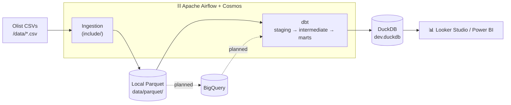
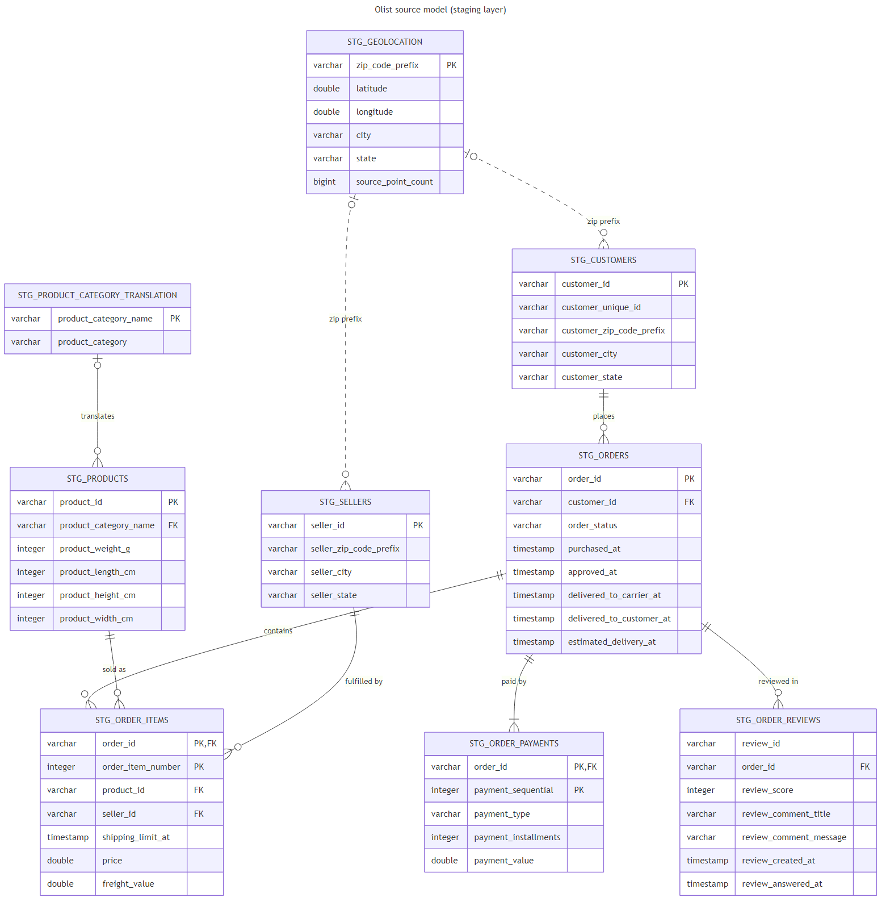
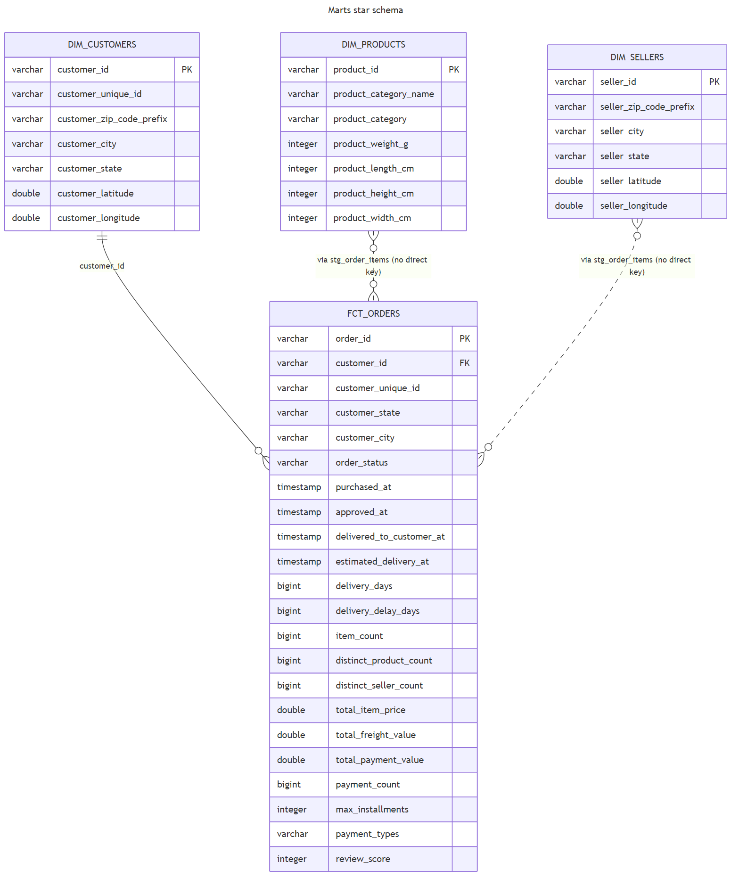
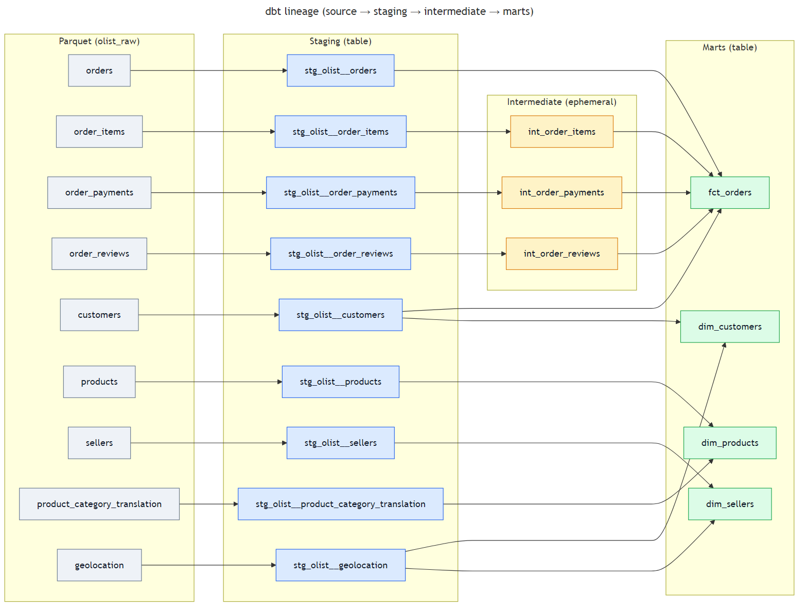

<div align="center">

# 🛒 Olist E-commerce Data Pipeline

**An end-to-end ELT pipeline for the Olist Brazilian e-commerce dataset — from raw CSVs to dashboard-ready marts.**

[](https://www.python.org/)
[](https://airflow.apache.org/)
[](https://astronomer.github.io/astronomer-cosmos/)
[](https://www.getdbt.com/)
[](https://duckdb.org/)
[](https://cloud.google.com/bigquery)
[](https://docs.astral.sh/uv/)
[]()

</div>

---

## 📖 Overview

This project ingests the public [Olist Brazilian e-commerce dataset](https://www.kaggle.com/datasets/olistbr/brazilian-ecommerce), turning nine raw CSV files into clean, business-ready data models. Raw CSVs are converted to **local Parquet**, transformed with **dbt** across `staging → intermediate → marts`, and orchestrated by **Apache Airflow** (running dbt through **Astronomer Cosmos**). The final marts feed **Looker Studio** and **Power BI** dashboards.

The warehouse runs on **DuckDB** locally; **BigQuery** is the planned cloud target and the loader is already wired (`include/loader/bigquery_loader.py`) — only credentials are missing.

## 🏗️ Architecture



| Stage | Tooling | Output |
|-------|---------|--------|
| **Ingestion** | `include/` Python modules | `data/parquet/*.parquet` (raw, all-string) |
| **Transformation** | dbt (via Cosmos) | `staging` → `intermediate` → `marts` |
| **Warehouse** | DuckDB (BigQuery planned) | `ecomerce/dev.duckdb` |
| **Serving** | Looker Studio / Power BI | Dashboards |

## 🧩 Data Model

The Olist source model is built around `orders`, linking customers, items, payments and reviews. Sellers and products attach through the order items, and `geolocation` (collapsed to one row per zip prefix) locates customers and sellers.



The marts form a star schema: the fact `fct_orders` (one row per order) with `dim_customers`, `dim_products` and `dim_sellers`.



<details>
<summary>dbt lineage</summary>



</details>

Every column is described in the **[data dictionary](docs/data_dictionary.md)**. Diagram sources live in `docs/diagrams/*.mmd`; regenerate the images with:

```bash
npx -y @mermaid-js/mermaid-cli@11.4.2 -i docs/diagrams/er_marts.mmd -o docs/img/er_marts.png -b white -s 2
```

## 🛠️ Tech Stack

- **Orchestration:** Apache Airflow 3.3.2 on [Astronomer](https://www.astronomer.io/) (Astro Runtime)
- **dbt orchestration:** Astronomer Cosmos (renders every dbt model as Airflow tasks)
- **Transformation:** dbt 1.12 (`dbt-duckdb` 1.11)
- **Warehouse:** DuckDB (local) · BigQuery (planned)
- **Ingestion:** pandas + PyArrow (CSV → Parquet, snappy)
- **Package manager:** [uv](https://docs.astral.sh/uv/)
- **Quality:** pytest (DAG integrity + ingestion unit tests), ruff, dbt tests
- **Python:** 3.13

## 📂 Project Structure

```
ecommerce-data-project/
├── dags/                              # Airflow DAGs (<source>__<domain>__<dest>__<schedule>)
│   ├── olist__orders__ingest__daily.py      # CSV → Parquet, then triggers transform
│   └── olist__orders__transform__daily.py   # dbt run + test via Cosmos
├── include/                           # Reusable pipeline modules
│   ├── config/      # datasets map + DAG tag constants
│   ├── extractor/   # CSV → DataFrame
│   ├── loader/      # Parquet writer + (lazy) BigQuery loader
│   ├── shared/      # helpers (column normalization, lineage)
│   └── pipeline/    # ingestion entrypoint (ingest_all)
├── ecomerce/                          # dbt project ("ecomerce", one "m" — intentional)
│   └── models/{staging,intermediate,marts}/
├── notebooks/
│   └── data_validation.ipynb          # data-quality checks against Parquet + marts
├── data/                              # raw CSVs + generated parquet/ (gitignored)
├── docs/
│   ├── data_dictionary.md             # every table and column
│   ├── diagrams/                      # Mermaid sources
│   └── img/                           # rendered diagrams (PNG + SVG)
└── tests/
    ├── dags/                          # DAG integrity tests
    └── include/                       # ingestion unit tests
```

## 🚀 Getting Started

### Prerequisites
- [uv](https://docs.astral.sh/uv/getting-started/installation/)
- [Astro CLI](https://www.astronomer.io/docs/astro/cli/install-cli) (to run Airflow locally, Docker-based)

> **Windows:** Airflow and Cosmos only install on Linux, so on native Windows `uv sync` installs everything except them (ingestion, dbt and the notebook work; DAG tests are skipped). For the full environment use WSL, or Docker via `astro dev start`.

### 1. Install dependencies
```bash
uv sync
```

### 2. Configure environment
```bash
cp .env.example .env   # dbt target, BigQuery settings (future)
```
Keep paths out of `.env`: dbt ≥ 1.12 auto-loads it. Container paths are set in the `Dockerfile`; local runs default to `data/parquet` and `ecomerce/` (override with `OLIST_PARQUET_DIR` / `DUCKDB_DIR`).

### 3. Ingest the raw data (CSV → Parquet)
```bash
uv run python -m include.pipeline.olist_ingestion
```

### 4. Run the dbt transformations
```bash
cd ecomerce
uv run dbt run  --profiles-dir .
uv run dbt test --profiles-dir .
```

### 5. Test and validate
```bash
uv run pytest            # DAG integrity + ingestion unit tests
uv run ruff check .
uv run jupyter notebook notebooks/data_validation.ipynb
```

## ⛓️ Orchestration (Airflow)

```bash
astro dev start     # start local Airflow (Docker)
astro dev stop
astro dev restart
```

DAG naming convention: `<source>__<domain>__<dest>__<schedule>.py`

| DAG | Trigger | What it does |
|-----|---------|--------------|
| `olist__orders__ingest__daily` | `@daily` | Maps over every Olist dataset (CSV → Parquet), then triggers the transform DAG |
| `olist__orders__transform__daily` | Triggered | Runs `dbt run` + `dbt test` per model via Cosmos |

All DAGs are validated by `tests/dags/` (≥ 2 retries and valid tags required).

## 🧱 dbt Layers

| Layer | Path | Materialization | Purpose |
|-------|------|-----------------|---------|
| **Staging** | `ecomerce/models/staging/` | table | Typed/renamed columns over the raw Parquet sources |
| **Intermediate** | `ecomerce/models/intermediate/` | ephemeral | Per-order aggregations (payments, items, reviews) |
| **Marts** | `ecomerce/models/marts/` | table | Business-ready models: `fct_orders`, `dim_customers`, `dim_products`, `dim_sellers` |

dbt reads the Parquet files directly through DuckDB `external_location` sources (`ecomerce/models/staging/source.yml`). Column descriptions are in each `schema.yml`, so `dbt docs generate && dbt docs serve` documents the whole project.

## 🗺️ Roadmap

- [x] Local ingestion (CSV → Parquet)
- [x] dbt `staging → intermediate → marts` on DuckDB
- [x] Airflow DAGs (ingest + Cosmos transform)
- [x] Data-quality validation notebook
- [x] Data model diagrams and data dictionary
- [ ] Enable BigQuery as the warehouse
- [ ] Looker Studio dashboard
- [ ] Power BI dashboard

## 📜 License

Personal project for educational purposes. The Olist dataset is published under its original [license on Kaggle](https://www.kaggle.com/datasets/olistbr/brazilian-ecommerce).
